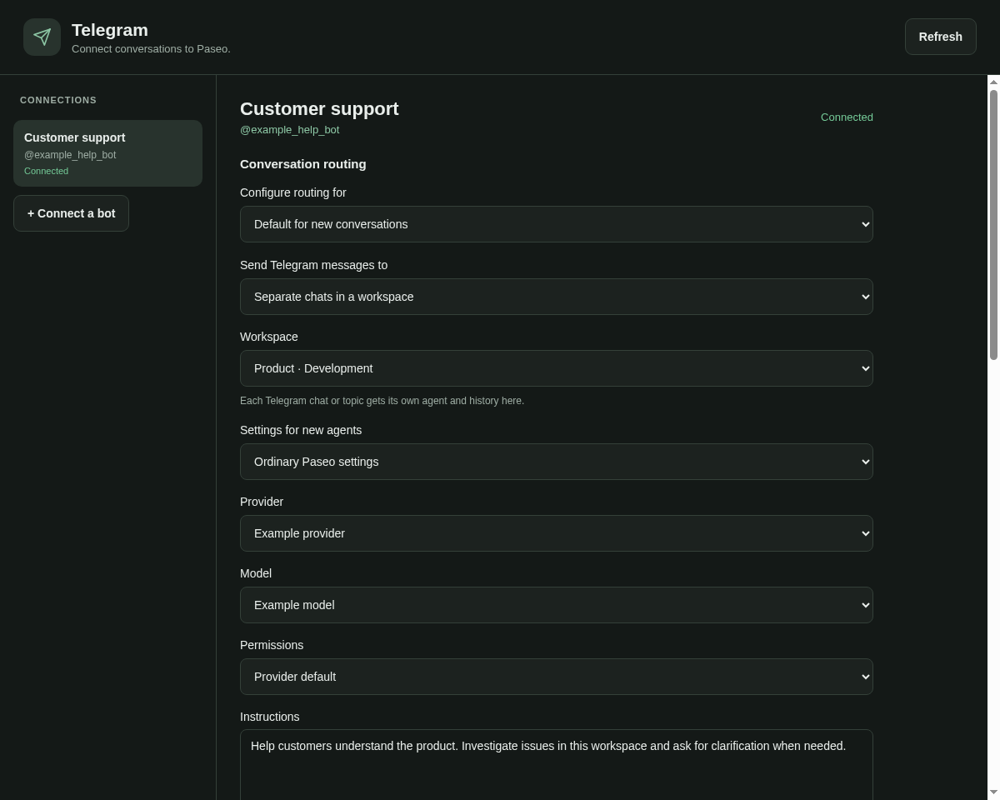

# Telegram for Paseo

Use your Paseo agents from Telegram. Connect an existing chat, or give every
Telegram group and topic its own conversation. The
[Bots plugin](https://github.com/oliexe/paseo-bots) is optional.



## Install

Requires a Paseo daemon and app on **0.11.2–0.11.x**, with Node **22.18+** on
the daemon host.

```sh
paseo plugin add npm:paseo-telegram
```

Open **Telegram** in the Paseo sidebar. No additional service, public webhook,
model API key, or rebuilt app is needed.

## Connect a bot

1. Create a Telegram bot with [@BotFather](https://t.me/BotFather).
2. In Paseo → Telegram, enter a connection name and its bot token.
3. Create the private setup link, open it with your Telegram account and press
   **Start**. This pairs the owner; the link expires after 30 minutes.
4. Choose a destination and access policy, then save.
5. Message the bot privately, or add it to a group from the paired account.

For ordinary group mentions, disable **Group Privacy** in BotFather before
adding the bot. If privacy changed after joining, remove and re-add it. Inline
Mode is unnecessary. An existing webhook is left intact; disconnect the bot's
other integration before enabling polling here. Only one integration should poll
a Telegram bot at a time.

One installation supports up to 20 bot connections, with separate tokens,
owners, queues, receipts and conversation mappings.

## Choose where messages go

| Destination               | Behavior                                                                                                              |
| ------------------------- | --------------------------------------------------------------------------------------------------------------------- |
| Existing Paseo chat       | Uses that exact agent and history. Keeps its model, instructions and permissions.                                     |
| Workspace                 | Creates an ordinary agent for each Telegram chat/topic, with separate history.                                        |
| Workspace + Bots profile  | Creates separate chats associated with the chosen Bots profile, using its model, prompt, memory and configured tools. |
| Workspace + Git worktrees | Creates a separate branch/workspace per conversation in the selected workspace's existing project.                    |

Set a default destination, then optionally override it for individual groups or
topics discovered by the bot. A group override applies to its topics unless a
topic has its own override. Changing a destination keeps the old chats and
worktrees. Profile settings apply when creating new agents; existing agents
keep their own settings.

Sharing an existing Paseo chat across multiple Telegram conversations requires
the explicit **Share this history** setting. Otherwise a second conversation is
rejected, including across separate bot connections. All authorized participants
inside the same Telegram group/topic use its same agent.

The linked agent is visible and usable in Paseo. Telegram-originated requests
and replies appear in both interfaces. Work initiated independently inside Paseo
is not automatically broadcast into Telegram.

## Choose who can use it

Only the paired owner can admit groups by adding the bot. The bot leaves groups
added by someone else. You can revoke admitted groups from the settings screen.

Direct messages default to **owner only**. Group requests default to **owner and
allowed users**. You can explicitly allow all group members or anyone in direct
messages. In groups, the default trigger is an `@mention`, an addressed
`/ask@your_bot` command, or a reply to the bot. An optional mode handles every
text message.

Requests run with the linked agent's ordinary tools, credentials and permissions.
Separate histories and Git branches do not isolate the host's filesystem or
credentials. Choose the Paseo permission mode to match the people allowed to
send requests. The connector does not automatically approve tool or plan
permissions; those remain in Paseo. Native clarification questions can be
answered in Telegram by replying with an option number or free text.

## While an agent works

- One editable message shows elapsed time, public progress and activity.
- The final answer replaces the progress message; long answers continue in
  additional messages.
- Bold, italic, code, links, quotes and lists use Telegram's native entities.
  Tables become labeled records that fit narrow screens.
- Requests are serialized per conversation and shared agent. Different agents
  can work concurrently.
- Pending requests survive reloads. Recovery follows the existing agent and
  checks dispatch receipts before sending anything again.
- Replies to questions are matched to the exact chat, topic and original form.
- Telegram write pacing and `retry_after` backoff apply across a chat's topics.

Private reasoning and tool arguments/output are excluded from progress updates.
This first release accepts text messages. Media input, voice transcription,
channel posts and Telegram Business connections are not implemented. Images in
agent Markdown remain links; diagrams and formulas are not rendered to images.

## Optional Git synchronization

Choose the remote and upstream branch. Before a new request, the connector
fetches upstream and checks the conversation's own branch while its agent is
idle. Clean branches fast-forward. Divergent committed work merges without
rewriting history. Staged, unstaged, untracked and ignored files are preserved.
Conflicts or local changes are handed to the agent for deliberate reconciliation;
an unresolved synchronization is marked in the reply.

The connector never automatically stashes, resets, rebases or force-pushes.
Clarification replies and resumed requests continue their original task without
fetching or changing Git mid-turn. It does not modify global Git identity or
Codex trust settings.

## Operation and updates

Reception starts with the daemon and works with the app closed. **Receive
Telegram messages** pauses reception/delivery while keeping chats and pending
requests. It does not stop running agents. Disconnecting removes the saved token
and connection configuration; it keeps chat history and worktrees.

```sh
paseo plugin update telegram
```

Updates use Paseo's normal plugin manager. This repository has no host-specific
deployment, server timers or automatic changes to installed daemons.

Connection data lives under `$PASEO_HOME/plugin-data/telegram` (or
`~/.paseo/plugin-data/telegram`). Tokens are in separate server-only files;
private files use mode `0600` and directories `0700` on Unix. Owner pairing stores
only a hash of the one-time nonce. Never publish this data directory or paste a
bot token into an issue.

## Development

```sh
npm ci --ignore-scripts
npm run typecheck
npm test
npm run check:package
```

The browser check renders the actual cross-platform screen with fixture RPCs
and host UI adapters. It checks saving both routing modes, optional Bots, token
masking, React errors and overflow at desktop/phone widths. It requires Chromium
or Chrome:

```sh
CHROME_BIN=google-chrome npm run check:browser
```

With the Paseo CLI installed, `npm run check:daemon` launches a disposable daemon
with a simulated Telegram API and proves reception before any app/RPC connects.
It never uses an existing daemon, bot token, model subscription or customer chat.

Paseo 0.11 exposes the server API only from RPC/lifecycle callbacks. The small
`server/daemon.ts` adapter uses the matching, pinned SDK's local connection
transport and instance credential for headless startup. It accepts only local
IPC/loopback endpoints and leaves daemon configuration unchanged. See
[the architecture](docs/architecture.md) for boundaries and release details.

Licensed under MIT.
